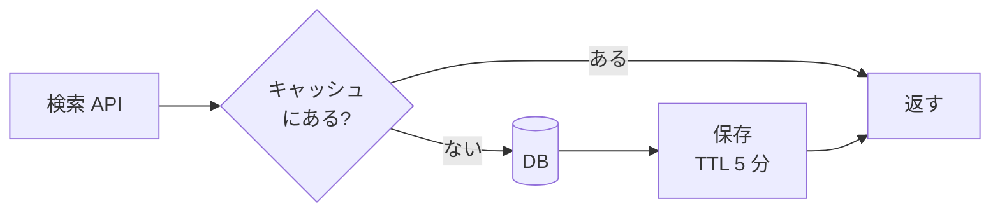
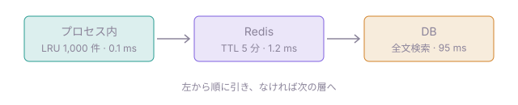

# 検索 API にキャッシュを入れた結果

> [!TIP]
> p95 は **412 ms → 96 ms** に下がりました。ヒット率は 1 週間で 78% に落ち着いています。

## 結果

| 指標 | 導入前 | 導入後 | 変化 |
| --- | ---: | ---: | ---: |
| p50 | 120 ms | 31 ms | −74% |
| p95 | 412 ms | 96 ms | −77% |
| DB クエリ / 分 | 18,400 | 4,050 | −78% |
| エラー率 | 0.21% | 0.19% | ±0 |

```chart 1 日ごとの p95 応答時間 (ms)
{
  "type": "line",
  "data": {
    "labels": ["月", "火", "水", "木", "金", "土", "日"],
    "datasets": [
      { "label": "導入前", "data": [405, 398, 421, 433, 412, 380, 377] },
      { "label": "導入後", "data": [140, 112, 101, 97, 94, 92, 96], "fill": true }
    ]
  }
}
```

## 仕組み



キャッシュの層は次のとおりです。



ヒット率の内訳:

<svg viewBox="0 0 640 44" role="img" aria-label="ヒット 78%、ミス 19%、期限切れ 3%" font-size="13">
  <rect x="0" y="8" width="499" height="28" rx="4" fill="var(--teal)"/>
  <rect x="503" y="8" width="118" height="28" fill="var(--violet)"/>
  <rect x="625" y="8" width="15" height="28" rx="4" fill="var(--amber)"/>
  <text x="12" y="27" fill="var(--ink)">ヒット 78%</text>
  <text x="514" y="27" fill="var(--ink)">ミス 19%</text>
</svg>

```sql
SELECT id, title FROM documents
WHERE tsv @@ plainto_tsquery($1)
ORDER BY rank DESC LIMIT 20;
```

> [!WARNING]
> 更新直後の 5 分間は古い結果が返ります。管理画面の更新だけは、保存時にキャッシュを消しています。

## 次にやること

- [x] p95 の監視アラートを 150 ms に下げる
- [ ] 期限切れの集中（同時に切れる）を TTL のゆらぎで散らす
- [ ] ヒット率をダッシュボードに出す
